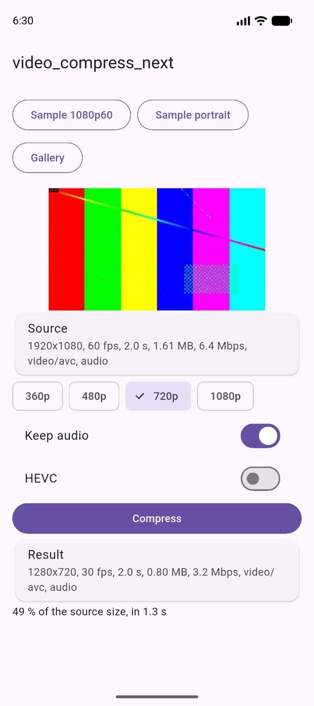

# video_compress_next

[](https://pub.dev/packages/video_compress_next)
[](https://github.com/Zalexei/video_compress_next/actions/workflows/ci.yml)

Video compression for Flutter on the phone's own hardware encoders:
**AndroidX Media3 Transformer** on Android and **AVFoundation** on iOS. No
FFmpeg, so it adds little to your app and raises no GPL questions.

It is a successor to [`video_compress`](https://pub.dev/packages/video_compress),
which has had no release since 2025-02-13 and has over 170 open issues. The
`video_compress` API is included, so moving over is a change of the
dependency and the import (see [below](#moving-from-video_compress)).

- Compress to a size limit (720p by default), with a bitrate picked from the
  output size and never above the source's.
- Progress from 0 to 1 and cancel, per task; several tasks can run at once.
- Trim, remove audio, cap the frame rate, H.264 or HEVC.
- Portrait and rotated videos stay the right way up.
- Media info (displayed size, rotation, duration, bitrate, frame rate, codec)
  and JPEG thumbnails as bytes or files.
- Works with Flutter 3.27 and newer and `compileSdk` 35.



## Platforms

| | Requirement | Engine |
|---|---|---|
| Android | `minSdk` 23, `compileSdk` 35 | Media3 Transformer 1.9.4 by default |
| iOS | 13.0 | `AVAssetReader` / `AVAssetWriter` |

On iOS the plugin builds with Swift Package Manager, which Flutter uses by
default from 3.44, and with CocoaPods.

On Android the plugin works with built-in Kotlin (AGP 9 with
`android.builtInKotlin=true`, Flutter 3.47+) and does not appear in Flutter's
"plugins that apply Kotlin Gradle Plugin" warning. With AGP 8 or built-in
Kotlin turned off it applies the Kotlin Gradle Plugin itself, which older
Flutter versions need.

### Choosing the Media3 version (Android)

Media3 1.9.x is the newest line that builds with `compileSdk` 35. If your app
already uses `compileSdk` 36, you can take a newer Media3 by adding this to
`android/gradle.properties`:

```properties
videoCompressNextMedia3Version=1.11.1
```

The plugin then compiles against `compileSdk` 36 itself.

## Usage

```dart
import 'package:video_compress_next/video_compress_next.dart';

final task = VideoCompressor.compress(
  path, // a file path, or on Android a content:// URI
  options: const CompressOptions(
    maxShortSide: 720,                  // the default
    trimStart: Duration(seconds: 2),
    trimEnd: Duration(seconds: 12),
    includeAudio: true,
    codec: VideoCodec.h264,
  ),
);
task.progress.listen((p) => print('${(p * 100).round()} %'));

try {
  final VideoInfo result = await task.result;
  print('${result.path}: ${result.width}x${result.height}, ${result.fileSize} bytes');
} on VideoCompressException catch (e) {
  if (e.error == VideoCompressError.cancelled) return;
  rethrow;
}

// Elsewhere, for example from a Cancel button:
await task.cancel();
```

Other calls:

```dart
final info = await VideoCompressor.getMediaInfo(path);
final jpeg = await VideoCompressor.getThumbnail(path, position: const Duration(seconds: 1), maxSide: 512);
final file = await VideoCompressor.getThumbnailFile(path);
await VideoCompressor.deleteAllCache(); // compressed videos and thumbnails
```

### Options

| Option | Default | Meaning |
|---|---|---|
| `maxShortSide` | 720 | The shorter side is scaled down to this. Never scaled up. |
| `maxLongSide` | none | The longer side is scaled down to this. |
| `videoBitrate` | auto | Bits per second. Auto is 0.1 bit per pixel per frame for H.264 (2.8 Mbps for 720p30), 0.065 for HEVC, never above the source's bitrate. |
| `maxFrameRate` | 30 | Frames above this rate are dropped. A slower video is not sped up. On Android, Media3 only drops from about 1.5 times the cap: 60 fps becomes 30, but 30 fps capped at 24 stays 30. |
| `includeAudio` | true | Audio is re-encoded to AAC. |
| `trimStart`, `trimEnd` | none | Positions in the source. |
| `codec` | `h264` | `hevc` falls back to H.264 if the device cannot encode it. |
| `deleteOrigin` | false | Deletes the source after success (file paths only). |
| `outputPath` | cache folder | Where to write the MP4. |

The planning (output size and bitrate) runs in Dart, in `planEncode`, so both
platforms produce the same size from the same input.

### Errors

Everything throws `VideoCompressException` with one of
`VideoCompressError.fileNotFound` (missing or not allowed to read),
`unsupported` (no video track, or a format the codecs cannot handle),
`cancelled` or `failed` (anything else, including codecs busy with another
app: worth trying again). Await `CompressTask.result` or give it an error
handler, even after `cancel()`: its failure is an error of that future.

The output is written to `<output>.part.mp4` and renamed when it is complete
and readable, so a failed or cancelled compression never leaves a broken file
at the output path or touches a file already there. An output path equal to
the input is refused.

On iOS a compression keeps running in the background only as long as iOS
allows, usually well under a minute; after that it fails with `failed`.

## Moving from video_compress

1. In `pubspec.yaml`, replace the dependency:

   ```yaml
   dependencies:
     # video_compress: ^3.1.4
     video_compress_next: ^0.1.0
   ```

2. Replace the import. `package:video_compress_next/video_compress.dart`
   has the same `VideoCompress`, `VideoQuality`, `MediaInfo`,
   `compressProgress$`, `Subscription` and the same methods, so this one
   command does it for a whole project:

   ```bash
   grep -rl "package:video_compress/" lib test | xargs perl -pi -e 's#package:video_compress/#package:video_compress_next/#g'
   ```

3. On Android, make sure `minSdk` is at least 23.

Existing code keeps compiling and behaves the same way, except for the
cases where the two platforms of `video_compress` disagreed or one of them had
a bug. Both platforms now behave the same:

| | video_compress 3.1.4 | video_compress_next |
|---|---|---|
| Output size per `VideoQuality` | Android limited the shorter side; iOS used export presets of other sizes | The Android sizes on both platforms: shorter side 720 (`DefaultQuality`), 360 (`LowQuality`), 640 (`MediumQuality`); `Res…Quality` fit inside that box |
| `HighestQuality` | Original size at a fixed 3.7 Mbps, so 4K came out blocky | Shorter side up to 1080 |
| Bitrate | Fixed or the transcoder's estimate | 0.1 bit per pixel per frame, never above the source's |
| `duration` argument | Android trimmed that many seconds off the end; iOS used it as the length | The length, on both |
| `MediaInfo.width` and `height` | Android swapped them for unrotated videos | The displayed size, after rotation, on both |
| Cancelled `compressVideo` | Android returned `null`; iOS returned the source's info with `isCancel: true` | `null` on both |
| Thumbnails | Android at most 512 px; iOS full size | At most 512 px on both |
| Cache folder | `video_compress` | `video_compress_next` |
| `setLogLevel` | Set the native log level | Does nothing |
| `frameRate` | Android used it only for `HighestQuality`; iOS set exactly that rate, speeding up slower videos by repeating frames | A cap for every quality, on both |
| Thumbnail `position` | Android read the milliseconds as microseconds (so nearly the first frame); iOS read them as seconds | Milliseconds on both, the frame at that moment |
| `getMediaInfo` or `getFileThumbnail` on a bad file | A null-check error | `VideoCompressException` |
| Compressed file names | `VID_<date><hash>.mp4` (Android), `<name><uuid>.mp4` (iOS) | `VID_<ms>_<n>.mp4` |
| `MediaInfo.path` from `getMediaInfo` | iOS removed `file://` | The path as given |
| `MediaMetadataRetriever` constants, `IVideoCompress.channel` | Exported | Not included |
| macOS | Supported | Not yet |

New code can switch to `package:video_compress_next/video_compress_next.dart`
for per-task progress and cancel, typed errors, HEVC and exact sizes.

## Status

Tested by the integration tests in
`example/integration_test` (media info, 1080p60 to 720p30, a rotated portrait
video, trim, audio removal, HEVC, cancel right after the start and during the
work, a 30 to 24 fps cap, a voice recording with 16 kHz mono sound, a missing
file, and the `video_compress` API):

- Android: Pixel 9a emulator, Android API 37, with Media3 1.9.4 and with
  1.11.1. The 2-second 1080p60 sample of 1.61 MB became 0.80 MB at 720p30
  in 1.1 s.
- iOS: iPhone 17 Pro simulator, iOS 26.1, with the plugin built through
  Swift Package Manager (Flutter 3.35 and 3.47.2) and through CocoaPods. The
  same sample became 0.70 MB in 0.5 s.
- Android on a real phone: Xiaomi 14T Pro (MediaTek Dimensity 9300+, Android
  16), hardware encoders. A 16-second portrait camera video (1080x1920,
  60 fps, HEVC, 41.5 MB) became 7.6 MB in H.264 at 720p30 in 3.5 s, and
  5.3 MB in HEVC in 3.2 s, the right way up.

Hardware encoders treat the bitrate as a target, not a limit: on the Xiaomi
the camera video came out about a third above it, and a noise-heavy test clip
almost twice. Emulators and simulators keep to it closely.

With the oldest supported Flutter, 3.27.4, the unit tests pass and a new app
with the plugin builds for Android (AGP 8.1, Kotlin 1.8.22); with Flutter
3.47.2 it builds with AGP 9.1 and Kotlin 2.4. CI checks both on every push
and builds the iOS example with Swift Package Manager and with CocoaPods.

Not tested yet: iPhones, other Android chips (Qualcomm, Exynos, Tensor), HDR
sources (Android tone-maps them to SDR with OpenGL; on iOS HDR colors may come
out wrong), and iOS builds with Flutter older than 3.35.

## Compared with other packages

On a Xiaomi 14T Pro with two 1080p60 camera videos, at each package's 720p
preset, video_compress_next was the fastest (3.5 to 5.3 s against 9.7 to
21.6 s for video_compress), made the smallest files and had the best SSIM
and PSNR. compress_video and v_video_compressor failed on that phone. Details,
limits and how to run it: [benchmark/README.md](benchmark/README.md).

## Development

```bash
flutter test                                    # Dart unit tests
cd example && flutter test integration_test -d <device>
# Add --dart-define=REAL_VIDEO=<path on the device> to also compress a real video.
dart run pigeon --input pigeons/messages.dart && dart format lib   # after editing the contract
```

The dev tools (Pigeon 26.0.1) work from Dart 3.6, the package's minimum, up.
The example app itself needs Dart 3.9 (Flutter 3.35) and `benchmark/` needs
Flutter 3.47.2. With Swift Package Manager the example app builds only from a
clone whose folder is named `video_compress_next`.

## License

MIT
